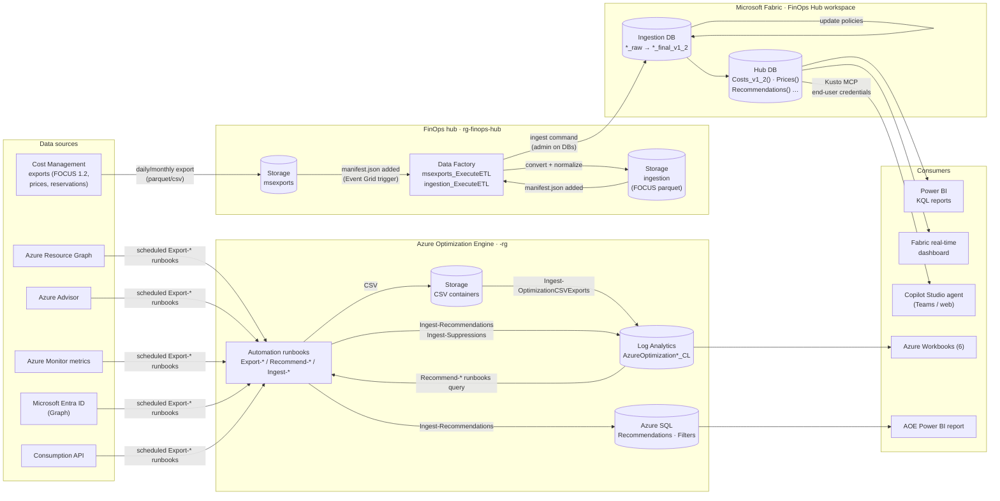
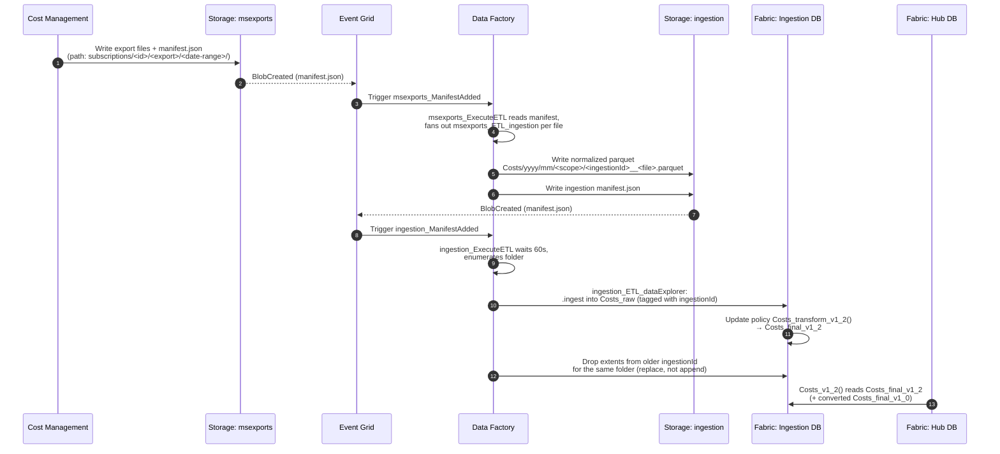
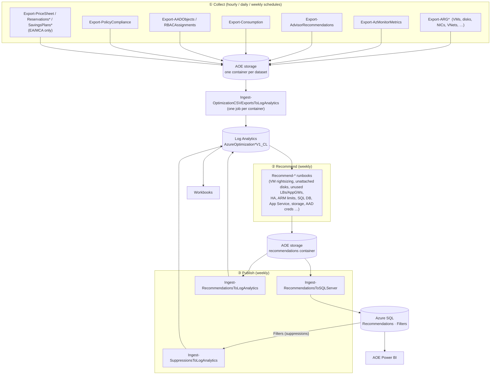
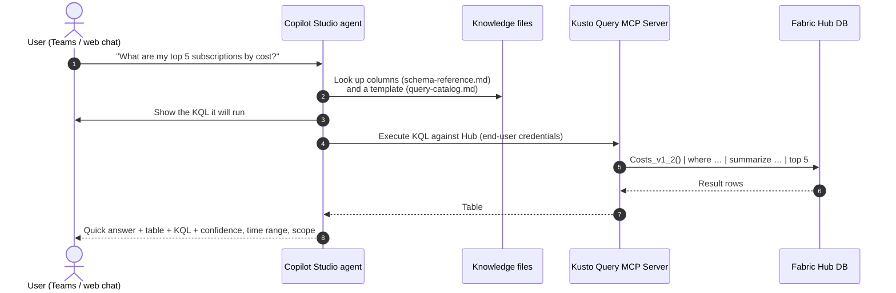

# FinOps toolkit architecture and data flow

This deployment combines three FinOps toolkit **v14** solutions on one subscription. Fabric and the hub run in one region (`<hub-region>`). AOE can run in a different region (`<aoe-region>`), which helps when Azure SQL isn't available to your subscription in the hub region:

1. **FinOps hub on Microsoft Fabric.** Ingests Cost Management data, normalizes it to FOCUS 1.2, and serves it from a Fabric eventhouse.
2. **Azure Optimization Engine (AOE).** Collects resource inventory, metrics, and Advisor data and turns them into optimization recommendations.
3. **Copilot Studio agent.** Answers cost questions in plain English by running KQL against the hub.

Power BI reports, Azure Workbooks, and a Fabric real-time dashboard sit on top of these.

For deployment steps, see [DEPLOYMENT-RUNBOOK.md](DEPLOYMENT-RUNBOOK.md).

---

## 1. Component inventory

| Layer | Resource | Name | Purpose |
|---|---|---|---|
| Fabric | Fabric capacity (F2) | `<capacity-name>` (`rg-finops-hub`) | Compute for the eventhouse. Billed while running; can be paused. |
| Fabric | Workspace | `FinOps Hub` | Container for the eventhouse and reports. Users get Viewer here. |
| Fabric | Eventhouse | `FinOpsHub` | KQL engine. Query URI `https://<eventhouse-id>.<zone>.kusto.fabric.microsoft.com` |
| Fabric | KQL database | `Ingestion` | Raw and final tables, plus the transforms between them. |
| Fabric | KQL database | `Hub` | Versioned query functions (`Costs_v1_2()` and others) that every consumer uses. |
| Hub | Storage account (ADLS Gen2) | `finopshub<unique>` | `msexports`, `ingestion`, and `config` containers. |
| Hub | Data Factory | `finops-hub-engine-<unique>` | Moves and transforms data from exports into Fabric. |
| Hub | Key Vault | `finops-hub-vault-<unique>` | Secrets for remote hubs. Not used in this deployment. |
| Hub | Managed identities | Data Factory system identity, plus deployment-script identities | Authentication between components. No stored keys. |
| AOE | Automation account | `<aoe-prefix>-auto` | About 45 PowerShell runbooks on schedules. |
| AOE | Storage account | `<aoe-prefix>sa` | CSV staging, one container per dataset. |
| AOE | Log Analytics workspace | `<aoe-prefix>-la` | `AzureOptimization*V1_CL` custom tables that back the workbooks. |
| AOE | Azure SQL Database | `<aoe-prefix>-sql` / `azureoptimization` | Recommendation history, suppressions (`Filters`), and ingestion control. |
| AOE | Workbooks (6 deployed) | Under the Log Analytics workspace | Interactive analysis in the Azure portal. The 5 benefits workbooks are held back until EA/MCA billing access exists. |
| Agent | Copilot Studio agent | `FinOps Hub Agent` | Turns natural-language questions into KQL and formats the results. |
| Fabric | Data agent | `FinOps Hub Data Agent` | Fabric-native conversational agent over the `Hub` functions. It can also be used as a tool from Copilot Studio. |
| Fabric | Real-Time Dashboard | `FinOps hub` | 12-page live dashboard, organized by FinOps Framework domain. |

---

## 2. End-to-end architecture

---

## 3. FinOps hub data flow (cost data → Fabric)

### Stage by stage

| # | Stage | What happens | Where |
|---|---|---|---|
| 1 | **Export** | Cost Management writes the `FocusCost` dataset (and optionally `PriceSheet`, `ReservationRecommendations`, `ReservationDetails`, `ReservationTransactions`) once a day for the current month and once a month for the closed month. Each run also writes a `manifest.json`. | `msexports` container |
| 2 | **Detect** | Event Grid fires when a `manifest.json` lands, which starts the `msexports_ManifestAdded` trigger. | Event Grid → Data Factory |
| 3 | **Transform** | `msexports_ExecuteETL` reads the manifest and runs `msexports_ETL_ingestion` once per file. That pipeline converts CSV to parquet, adds hub metadata, and writes FOCUS-aligned files. Prices are joined in later to fill list and contracted prices, so export **prices before costs**. | Data Factory → `ingestion` |
| 4 | **Stage** | Files are laid out by dataset, month, and scope. Every file in one run shares an `ingestionId` prefix. A new `manifest.json` marks the run complete. | `ingestion` container |
| 5 | **Ingest** | `ingestion_ExecuteETL` (trigger `ingestion_ManifestAdded`) runs `ingestion_ETL_dataExplorer`. It issues `.ingest` commands into the matching `*_raw` table in the Fabric **Ingestion** database, using the Data Factory managed identity, which is an admin on both databases. | Data Factory → Fabric |
| 6 | **Normalize** | KQL update policies run `*_transform_v1_2()` as data arrives and write to `*_final_v1_2` tables. With retention 0, `_raw` data is dropped right away. Extents from earlier runs for the same folder are dropped, so re-exports replace data instead of duplicating it. | Ingestion DB |
| 7 | **Serve** | The **Hub** database exposes versioned functions: `Costs_v1_2()`, `Prices_v1_2()`, `Recommendations_v1_2()`, `CommitmentDiscountUsage_v1_2()`, `Transactions_v1_2()`, plus unversioned aliases such as `Costs()`. Consumers always query these functions, never the tables, so schemas stay stable across toolkit upgrades. | Hub DB |
| 8 | **Configure** | `config_SettingsUpdated` reacts to changes in `config/settings.json`. `config_DailySchedule` and `config_StartExportProcess` / `config_ConfigureExports` drive *managed exports*, which this deployment doesn't use. | Data Factory |

### Tables and functions

| Ingestion DB (tables) | Hub DB (functions used by consumers) |
|---|---|
| `Costs_raw` → `Costs_final_v1_2` | `Costs_v1_2()` / `Costs()`: FOCUS 1.2 cost and usage, plus `x_` Azure extensions |
| `Prices_raw` → `Prices_final_v1_2` | `Prices_v1_2()` / `Prices()` |
| `Recommendations_raw` → `Recommendations_final_v1_2` | `Recommendations_v1_2()` / `Recommendations()`: reservation recommendations |
| `CommitmentDiscountUsage_raw` → `…_final_v1_2` | `CommitmentDiscountUsage()` |
| `Transactions_raw` → `Transactions_final_v1_2` | `Transactions()` |
| `PricingUnits`, `Regions`, `ResourceTypes`, `Services` (open data) | `PricingUnits()`, `Region()`, `ResourceType()`, `Services()` |
| `HubSettingsLog` | n/a |

### Why Data Factory is still needed with Fabric

Fabric replaces **Azure Data Explorer** as the analytics store. It doesn't replace the ingestion engine. Data Factory still detects exports, converts and normalizes files, issues the ingest commands, and manages replace semantics. The v14 hub template always deploys Data Factory. It bills per pipeline run, which is typically a few dollars a month for one subscription.

---

## 4. Azure Optimization Engine data flow

1. **Collect.** Export runbooks run as the Automation account's managed identity. They query Resource Graph, Monitor, Advisor, Consumption, Microsoft Graph, and Policy, and write CSVs to per-dataset containers.
2. **Ingest.** `Ingest-OptimizationCSVExportsToLogAnalytics` sends each new CSV to Log Analytics as a custom table (`AzureOptimizationVMsV1_CL`, `…ConsumptionV1_CL`, and so on). `LogAnalyticsIngestControl` in SQL tracks progress.
3. **Recommend.** Weekly `Recommend-*` runbooks join inventory, metrics, and cost in Log Analytics and write recommendation files with a fit score and estimated savings.
4. **Publish.** Recommendations go to SQL for history and Power BI, and to `AzureOptimizationRecommendationsV1_CL` for workbooks. Suppressions you add with `Suppress-Recommendation.ps1` are stored in SQL `Filters` and copied to `AzureOptimizationSuppressionsV1_CL`.
5. **Remediate (optional).** `Remediate-*` runbooks act on filtered recommendations, such as deleting unattached disks or deallocating long-stopped VMs. They aren't scheduled by default.

### Workbook → table dependencies

| Workbook | Tables it requires | Populated when |
|---|---|---|
| Recommendations | `RecommendationsV1`, `SuppressionsV1`, `ResourceContainersV1` | Weekly. `Initialize-AoeData.ps1` runs it once immediately and seeds the Suppressions schema. |
| Resources Inventory | ARG tables (VMs, disks, NICs, NSGs, VNets, …), `RBACAssignmentsV1` | Daily |
| Costs Growing | `ConsumptionV1`, `ResourceContainersV1` | Daily |
| Block Blob Storage Usage | `ConsumptionV1`, `ResourceContainersV1` | Daily |
| Policy Compliance | `PolicyStatesV1`, `ResourceContainersV1` | Daily |
| Identities and Roles | `AADObjectsV1`, `RBACAssignmentsV1` | Daily. Needs Global Reader on the AOE identity. |
| Benefits Simulation / Benefits Usage / Reservations Potential / Reservations Usage / Savings Plans Usage | `PricesheetV1`, `ReservationsPriceV1`, `ReservationsUsageV1`, `SavingsPlansUsageV1` | Only with `DeployBenefitsUsageDependencies = y` and an **EA billing account or MCA billing profile** |

---

## 5. Copilot Studio agent flow

- **Instructions** (`agent-instructions.md`) define the analyst role, the cluster URI and database, and these rules: always query `Costs_v1_2()`, never answer from the knowledge files alone, separate marketplace costs, and account for the 24–48 hour data lag.
- **Knowledge** (`knowledge/*.md`) is used to *build* queries: the column reference, 16 query templates, and the weekly anomaly-report workflow.
- **Tools.** The **Kusto Query MCP Server** runs as the signed-in user, so each person sees only data they have access to; grant Viewer on the `FinOps Hub` workspace. The **Microsoft Learn Docs MCP** provides FinOps and FOCUS concept lookups.
- **First interaction.** The agent detects the billing currency, then asks the user to pick a scope (billing account, subscription, resource group, tag, or all) and applies it to every later query.

---

## 6. Identity and access

| Principal | Needs | On | Why |
|---|---|---|---|
| Hub Data Factory managed identity | Storage Blob Data Contributor (set by the template) | Hub storage | Read exports, write parquet |
| Hub Data Factory managed identity | **Database admin** (`.add database … admins`) | Fabric `Ingestion` and `Hub` | Run ingest and extent-management commands |
| Cost Management | Writes to `msexports` | Hub storage | Exports |
| AOE Automation managed identity | Reader (set by the template) | Subscription | Resource Graph, Advisor, Monitor, Consumption |
| AOE Automation managed identity | Storage Blob Data Contributor and Log Analytics access (template) | AOE storage and workspace | Stage CSVs, ingest |
| AOE Automation managed identity | SQL access (template; Entra-only authentication) | AOE SQL | Recommendations, filters, control tables |
| AOE Automation managed identity | **Global Reader** (Entra, granted manually) | Tenant | Identities and Roles workbook, expiring-credential recommendations |
| AOE Automation managed identity | Enterprise Enrollment Reader (EA) or Billing profile reader (MCA) | Billing scope | Benefits workbooks (optional) |
| Report and agent users | Viewer | Fabric workspace | Power BI KQL reports, dashboard, agent |
| Workbook users | Log Analytics Reader | AOE workspace | Workbooks |

---

## 7. Networking and tenant policy constraints

Both solutions are deployed with **public routing**: endpoints are reachable over the internet and protected by Entra ID and RBAC.

Many organizations assign Azure Policy *Modify* or *DeployIfNotExists* policies that harden storage accounts automatically. Two common ones break this deployment:

| Policy effect | Impact |
|---|---|
| Forces `allowSharedKeyAccess = false` | ARM deployment scripts can't use their temporary storage account, so the hub deployment fails (`KeyBasedAuthenticationNotPermitted`). Later, Cost Management exports fail with "Key-based authentication is currently disabled on this storage account". |
| Forces `publicNetworkAccess = Disabled` | Data Factory, Cost Management exports, and AOE Automation sandboxes can't reach storage over the public endpoint. AOE runbooks fail with `403 AuthorizationFailure`. |

Before you deploy, ask your policy owners for an exemption on both resource groups. That's typically a policy exemption or an exclusion tag your organization recognizes. Remediation can also run *after* deployment. If exports or AOE jobs suddenly start failing with the errors above, check whether the exemption expired or the tag was removed, then re-enable shared-key and public network access on both storage accounts. The hub's private-routing option still creates a deployment-script storage account that relies on shared-key access, so it doesn't avoid the problem.

Azure SQL Database is **restricted in some regions for some subscriptions**, often including West US 2, East US, and East US 2. If AOE fails to create SQL, deploy AOE to another region, or open a *Service and subscription limits* support request.

---

## 8. Timing and latency

| Flow | Cadence | First data after deployment |
|---|---|---|
| Cost Management `FocusCost` export | Daily (current month), monthly (closed month) | Minutes after a backfill run. Cost data itself lags 24–48 hours. |
| Hub ingestion into Fabric | Event-driven, per manifest | About 5–15 minutes after the export lands |
| AOE inventory, consumption, policy, RBAC | Daily | Immediately with `Initialize-AoeData.ps1`, otherwise next day |
| AOE metrics | Hourly | First hour |
| AOE recommendations | Weekly | Immediately with `Initialize-AoeData.ps1`, otherwise up to 7 days |
| Copilot agent and Power BI | On demand | As soon as `Costs_v1_2() \| count` > 0 |

---

## 9. Cost drivers

| Resource | Rough monthly cost | Notes |
|---|---|---|
| Fabric F2 capacity | About $263 if always on | Pause when idle; queries and ingestion fail while paused |
| Hub storage + Data Factory + Event Grid | About $5–20 | Scales with export volume and pipeline runs |
| AOE SQL (serverless/basic) + Automation + storage | About $20–60 | Runbook minutes and SQL tier |
| AOE Log Analytics | About $10–50 | Ingestion GB and 120-day retention |
| Copilot Studio | Licensing | Microsoft 365 Copilot or Copilot Studio license |
